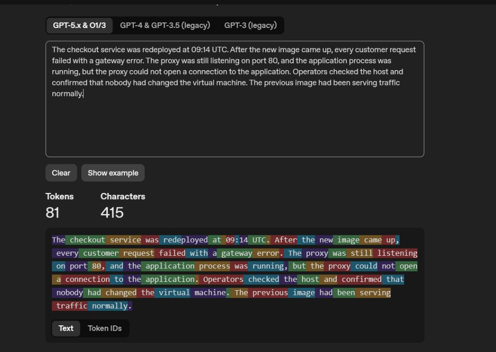
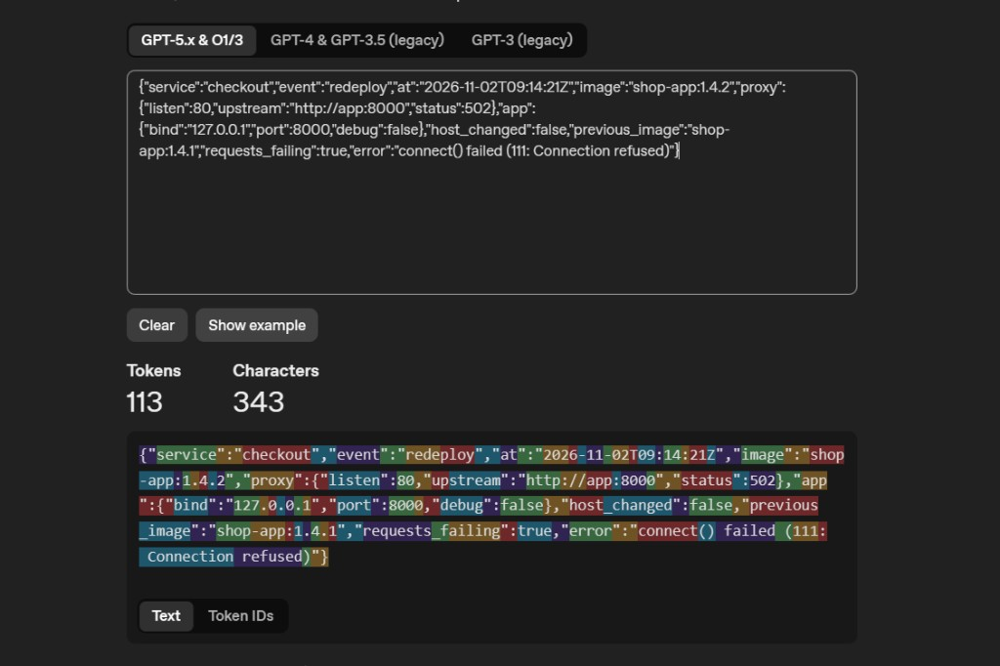
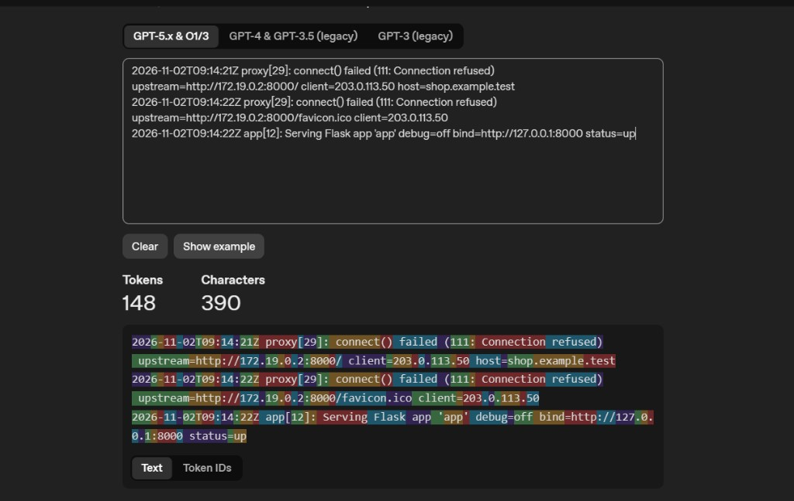
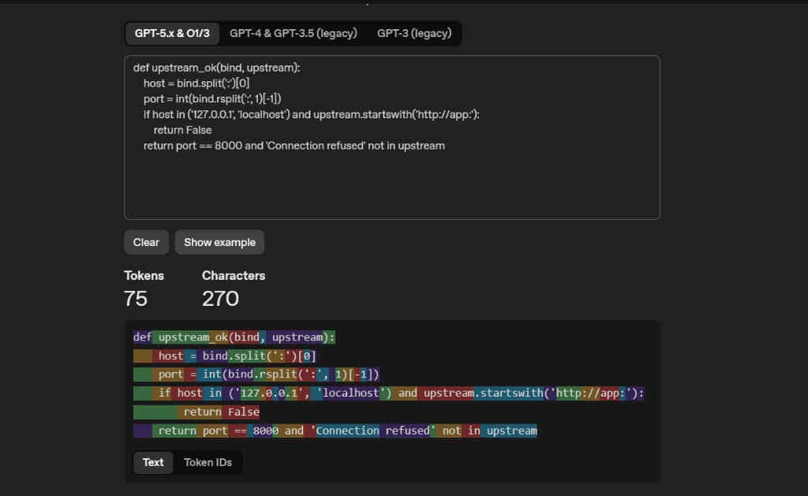
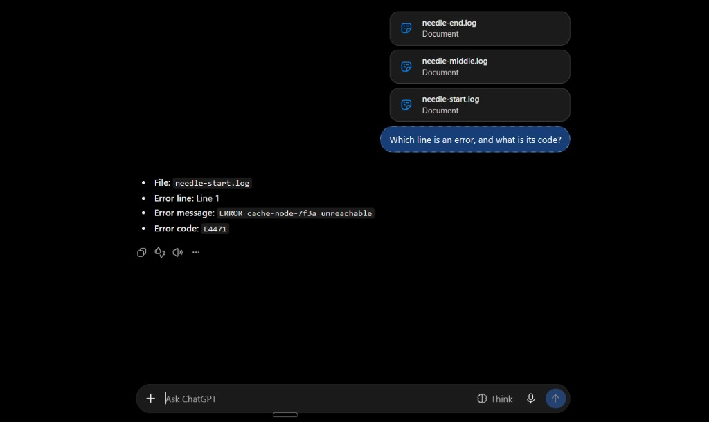
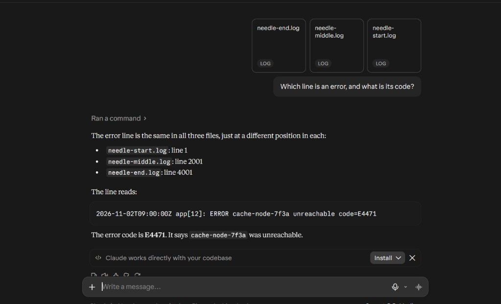
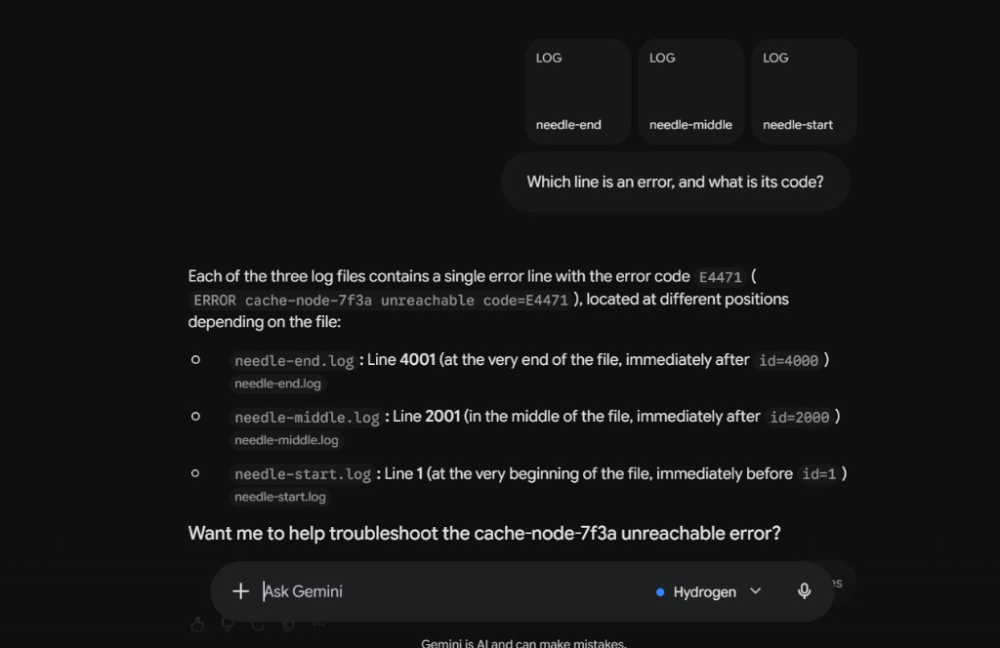

# Token & Context Window Experiment

This note covers two tests:

1. Comparing token counts across four text formats (`tiktoken` `cl100k_base` and the OpenAI web tokenizer).
2. Checking whether ChatGPT, Claude, and Gemini can locate one hidden error line across three 4,001-line generated log files.

---

## 1. How Different Text Formats Tokenize

I tested four short samples of similar visible length: a plain English paragraph, a JSON payload, three server log lines, and a small Python function.

| Format | Characters | `tiktoken` (`cl100k_base`) | OpenAI Web (`GPT-5.x`) | Approx. Chars / Token |
| --- | ---: | ---: | ---: | ---: |
| Plain English paragraph | 415 | 82 | 81 | ~5.1 |
| Python function | 271 | 73 | 75 | ~3.7 |
| JSON object | 343 | 113 | 113 | ~3.0 |
| Server log lines (3 lines) | 391 | 149 | 148 | ~2.6 |

*Note: Small 1–2 token differences between `tiktoken` and the web page come from using different tokenizers (and a 1-character newline difference on paste). The `tiktoken` numbers are my main measured baseline.*

### Why the counts differ

- **Plain English is cheapest** (~5 characters per token) because common words map to single tokens.
- **Python code stays moderate** (~3.7 characters per token) because keywords and simple identifiers (`def`, `return`, `host`) stay whole.
- **JSON costs noticeably more** (~3.0 characters per token) because quotes, braces, colons, and commas add many extra tokens.
- **Logs cost the most** (~2.6 characters per token) — almost double the tokens of plain text of similar length — because timestamps, IP addresses, ports, and symbols split into many small pieces.

### Takeaway

Visible length is misleading. Logs, JSON, and configs consume context-window space much faster than plain English, so pasting only the relevant lines saves both context space and cost.

### Tokenizer Screenshots

**Plain English Paragraph (81 tokens on web / 82 in `tiktoken`)**



**JSON Object (113 tokens on web / 113 in `tiktoken`)**



**Server Log Lines (148 tokens on web / 149 in `tiktoken`)**



**Python Function (75 tokens on web / 73 in `tiktoken`)**



---

## 2. Finding a Single Error in Large Log Files

### Test Files

I generated 4,000 repeated normal log lines:

```text
2026-11-02T09:00:00Z app[12]: request ok id=N latency=(N % 90)ms
```

Then I inserted one error line into three separate files at different positions:

```text
2026-11-02T09:00:00Z app[12]: ERROR cache-node-7f3a unreachable code=E4471
```

| File | Error Position | Lines | Size | Tokens (`cl100k_base`) |
| --- | --- | ---: | ---: | ---: |
| `logs/needle-start.log` | Line 1 (start) | 4,001 | 246,519 chars | 111,032 |
| `logs/needle-middle.log` | Line 2,001 (middle) | 4,001 | 246,519 chars | 111,032 |
| `logs/needle-end.log` | Line 4,001 (end) | 4,001 | 246,519 chars | 111,032 |

### Prompt

I attached all three log files in a fresh chat on each model and asked:

> Which line is an error, and what is its code?

All three platforms accepted the files without any size rejection.

### Model Results

| Model | Start (`line 1`) | Middle (`line 2001`) | End (`line 4001`) | Summary |
| --- | --- | --- | --- | --- |
| **ChatGPT** | Found (`E4471`) | Missed | Missed | Incomplete — reported only `needle-start.log` and ignored the other two files |
| **Claude** | Found (`E4471`) | Found (`E4471`) | Found (`E4471`) | Complete — found the exact line number and `E4471` in all three files |
| **Gemini** | Found (`E4471`) | Found (`E4471`) | Found (`E4471`) | Complete — found the exact line number and `E4471` in all three files |

### What This Showed

Accepting large files does not guarantee the model will examine all of them thoroughly. ChatGPT grabbed the first match at line 1 of `needle-start.log` and stopped, skipping the middle and end files completely. Claude and Gemini checked every file and returned all three positions accurately.

In real troubleshooting, I should not drop huge logs into a chat and assume the model read everything — I should filter down to the relevant lines or verify each file myself.

### Model Screenshots

**ChatGPT — Incomplete (reported only `needle-start.log`)**



**Claude — Complete (all three positions found)**



**Gemini — Complete (all three positions found)**



---

## Appendix: Sample Texts Used

### Plain English Paragraph

```text
The checkout service was redeployed at 09:14 UTC. After the new image came up, every customer request failed with a gateway error. The proxy was still listening on port 80, and the application process was running, but the proxy could not open a connection to the application. Operators checked the host and confirmed that nobody had changed the virtual machine. The previous image had been serving traffic normally.
```

### JSON Object

```json
{"service":"checkout","event":"redeploy","at":"2026-11-02T09:14:21Z","image":"shop-app:1.4.2","proxy":{"listen":80,"upstream":"http://app:8000","status":502},"app":{"bind":"127.0.0.1","port":8000,"debug":false},"host_changed":false,"previous_image":"shop-app:1.4.1","requests_failing":true,"error":"connect() failed (111: Connection refused)"}
```

### Server Log Lines

```text
2026-11-02T09:14:21Z proxy[29]: connect() failed (111: Connection refused) upstream=http://172.19.0.2:8000/ client=203.0.113.50 host=shop.example.test
2026-11-02T09:14:22Z proxy[29]: connect() failed (111: Connection refused) upstream=http://172.19.0.2:8000/favicon.ico client=203.0.113.50
2026-11-02T09:14:22Z app[12]: Serving Flask app 'app' debug=off bind=http://127.0.0.1:8000 status=up
```

### Python Function

```python
def upstream_ok(bind, upstream):
    host = bind.split(':')[0]
    port = int(bind.rsplit(':', 1)[-1])
    if host in ('127.0.0.1', 'localhost') and upstream.startswith('http://app:'):
        return False
    return port == 8000 and 'Connection refused' not in upstream
```
